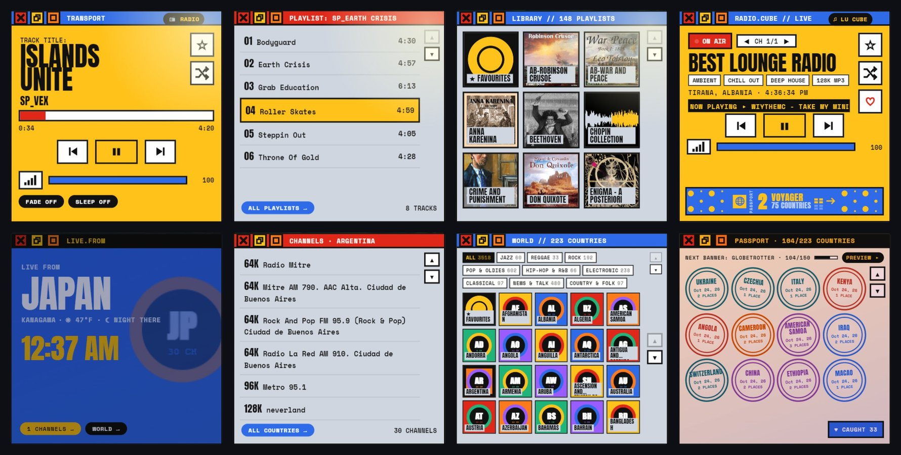
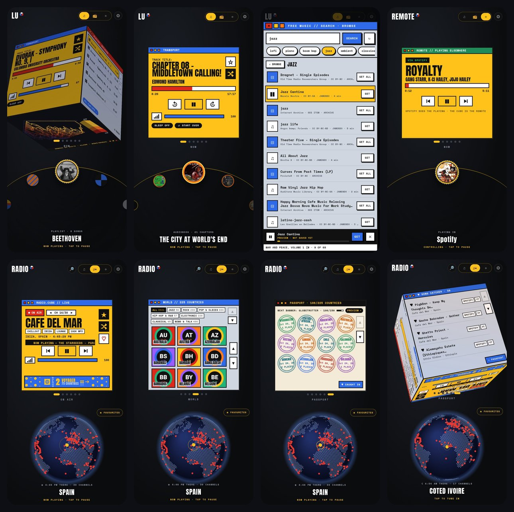

# Lu Cube

**A music wheel that turns into a 3D cube. Spin it and find out what's on the other sides.** (Pronounced "Lou Cube".)

### On a PC

### On a phone

**Website:** https://buildbeyond1889.github.io/LuCube/

A wheel of your playlists sits on the edge of your screen. Drag a record off it and it becomes a cube floating over your desktop, with a different working face on each side: transport, cover, playlist, library, visualiser and more. Press **R** and the whole cube flips to live radio from around the world. Your own music needs no internet and no account.

## Get it
1. **[Download the zip](https://github.com/BuildBeyond1889/LuCube/archive/refs/heads/main.zip)** and unzip it anywhere.
2. Put folders of songs in `Music\` (each folder is a playlist), or run **Get Classical Music.bat** / **Get Lofi Music.bat** for free music.
3. Run **Lu Cube Desktop.bat** for the floating cube, or **Lu Cube.bat** for a normal window.

Windows 10 or 11. If Python isn't installed, Lu Cube downloads the official portable Python from python.org (about 11 MB). The desktop cube downloads Electron once (about 100 MB).

## Your music
- MP3, FLAC, M4A, OGG and WAV all play. A `cover.jpg` in a folder is its art.
- Favourites, shuffle, crossfade, gapless albums, sleep timer, and media keys.
- **Get Classical Music.bat** downloads public-domain classical recordings from the Internet Archive (CC0 / Public Domain Mark only, credited). **Get Lofi Music.bat** downloads credited Creative Commons lofi albums.
- **Set Weather Town.bat** sets your town, and the cube takes on your weather and time of day.
- **Get Audiobooks.bat** pulls classic public-domain audiobooks from LibriVox (via the Internet Archive). Each book lands in `Music\<Book>\` with its chapters in order and a `cover.jpg`, and shows up as its own playlist.

## Unfold
Pull the cube open and its faces lay out flat as one big window: the list on the left (channels, favourites or your playlist), the player in the middle, the world and your caught songs on the right. Pong plays itself above the player (click to join in), and one click sends the visualiser full screen. Shatter it and the pieces fly back to the wheel.

## Radio
Press **R** (or the 📻 bubble on the wheel) to switch. A line of light sweeps across every face, and whatever you were playing waits, paused, until you switch back.

- The most-played stations in every country, from the free [radio-browser.info](https://www.radio-browser.info) directory. That's about 50,000 stations in about 200 countries. The list is fetched once and refreshed weekly.
- **Faces:** On Air (with the song the station is playing, when it sends it) · Live From (local time and weather) · Channels · World (genre filter) · Wake-up (alarm and world clocks) · Passport.
- **Passport:** a stamp for each country you listen to. Reach 25, 75, 150 and 197 countries to earn a permanent banner (Wanderer, Voyager, Globetrotter, Citizen of Earth).
- **Search** finds any station in the world by name, town, state or genre.

## Give it to someone
Run **Make Lu Cube Stick.bat** with a USB stick plugged in. On the other computer, run **Install Lu Cube.bat** from the stick: it installs Lu Cube, downloads music if they want it, and makes a shortcut. Computers that already have Lu Cube update themselves when the stick is plugged in.

## Phone (Android)
**[Download LuCube.apk](https://github.com/BuildBeyond1889/LuCube/releases/download/phone-latest/LuCube.apk)** on the phone and open it (Android asks once to allow installs from your browser). Android 7 or newer.

The same cube and faces, with a thumb wheel for your playlists and a globe for the radio. It plays through the phone's own media player, so the lock screen, headphones, Bluetooth and **Android Auto** all work. Plus:
- **Add Music:** the cube's top face. Pick songs or a whole folder from the phone or Drive, share songs to Lu Cube from any app, or open the two free libraries:
  - **Free Music:** search the Internet Archive and Openverse or browse 56 genres. Tap to preview, GET to keep.
  - **Books & Podcasts:** free LibriVox audiobooks with a one-tap starter shelf, and any podcast you can name. Star a show and new episodes download by themselves on Wi-Fi.
- **Audiobooks and podcasts** remember where you stopped, swap ⏮ ⏭ for back 15 / forward 30 (on the lock screen too; hold for the previous or next chapter), and show episode release dates, newest on top. The wheel groups music, books and podcasts, ringed yellow, orange and red.
- **Lu Blocks:** a block puzzle on all six faces of the cube, opened from the Add Music face.
- **Tidy up:** the library face's red ✕ takes a playlist off the cube. Your own files stay on the phone; anything Lu Cube downloaded is deleted and can be got again.
- **◎ Remote:** with notification access, the cube shows and controls whatever Spotify, YouTube Music or a podcast app is playing.
- **Song Catcher:** tap ♥ CATCH when a station shows a song you like; find it later in Spotify or YouTube Music.
- **Home-screen widget, sunrise alarm** (wake to a station where it's morning right now), **even volume, data saver.**
- **Cube skins** unlocked by passport banners.
- **Sync with your PC:** run `Phone Sync.bat` on the PC, then ⚙ → Sync on the phone (same Wi-Fi). Songs copy over; passport stamps, radio favourites and caught songs merge both ways.

Android Auto only lists apps from the Play Store until you turn on *Unknown sources* (Android Auto settings → tap *Version* ten times → ⋮ → Developer settings).

## iPhone and iPad (web app)

Open **https://buildbeyond1889.github.io/LuCube/app/** in Safari, then Share → Add to Home Screen. No App Store or account needed. The iPhone gets the phone layout. The iPad gets the full cube, with the unfold window, Pong and the depth visualiser. Tap **＋ ADD SONGS** to copy songs in from Files; they stay in the app and play offline.

Apple puts some limits on web apps: music may pause when the screen locks, volume follows the side buttons, there are no station song titles, the visualiser animates on its own instead of following the sound, and there's no remote mode or PC sync. Add Music, audiobooks, podcasts and Lu Blocks are Android only.

## Credits
Stations: [radio-browser.info](https://www.radio-browser.info) · Weather: [Open-Meteo](https://open-meteo.com) · Free music and audiobooks: [Internet Archive](https://archive.org), [LibriVox](https://librivox.org), [Openverse](https://openverse.org) and Musopen · Podcast directory: Apple Podcasts search · Fonts: Anton, Space Mono and Inter under the SIL Open Font License (`web/fonts`).

© 2026 BuildBeyond1889. All rights reserved; see `LICENSE`.

