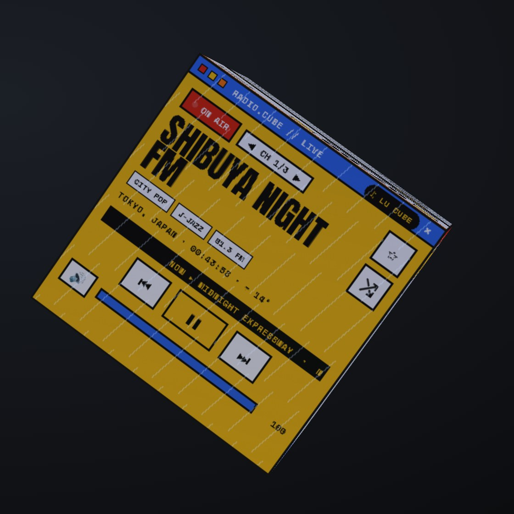

# Lu Cube

**A music wheel that turns into a 3D cube.** (Pronounced "Lou Cube".)

**Website:** https://buildbeyond1889.github.io/LuCube/

A wheel of your playlists sits on the edge of your screen. Drag a record off it and it becomes a cube floating over your desktop, with a different working face on each side: transport, cover, playlist, library, lyrics and visualiser. Press **R** and the whole cube flips to live radio from around the world. Your own music needs no internet and no account.

## Get it
1. **[Download the zip](https://github.com/BuildBeyond1889/LuCube/archive/refs/heads/main.zip)** and unzip it anywhere.
2. Put folders of songs in `Music\` (each folder is a playlist), or run **Get Classical Music.bat** / **Get Lofi Music.bat** for free music.
3. Run **Lu Cube Desktop.bat** for the floating cube, or **Lu Cube.bat** for a normal window.

Windows 10 or 11. If Python isn't installed, Lu Cube downloads the official portable Python from python.org (about 11 MB). The desktop cube downloads Electron once (about 100 MB).

## Your music
- MP3, FLAC, M4A, OGG and WAV all play. A `cover.jpg` in a folder is its art; `song.lrc` next to `song.mp3` gives synced lyrics.
- Favourites, shuffle, crossfade, gapless albums, sleep timer, and media keys.
- **Get Classical Music.bat** downloads public-domain classical recordings from the Internet Archive (CC0 / Public Domain Mark only, credited). **Get Lofi Music.bat** downloads credited Creative Commons lofi albums.
- **Set Weather Town.bat** sets your town, and the cube takes on your weather and time of day.

## Radio
Press **R** (or the 📻 bubble on the wheel) to switch. A line of light sweeps across every face, and whatever you were playing waits, paused, until you switch back.

- The most-played stations in every country, from the free [radio-browser.info](https://www.radio-browser.info) directory. That's about 50,000 stations in about 200 countries. The list is fetched once and refreshed weekly.
- **Faces:** On Air (with the song the station is playing, when it sends it) · Live From (local time and weather) · Channels · World (genre filter) · Wake-up (alarm and world clocks) · Passport.
- **Passport:** a stamp for each country you listen to. Reach 25, 75, 150 and 197 countries to earn a permanent banner (Wanderer, Voyager, Globetrotter, Citizen of Earth).
- **Search** finds any station in the world by name, town, state or genre.

## Give it to someone
Run **Make Lu Cube Stick.bat** with a USB stick plugged in. On the other computer, run **Install Lu Cube.bat** from the stick: it installs Lu Cube, downloads music if they want it, and makes a shortcut. Computers that already have Lu Cube update themselves when the stick is plugged in.

## Phone (in the works)
Android first, iPhone later. It's the same cube, plus a remote mode that shows and controls whatever Spotify, YouTube Music or podcasts are playing. **[Try the mockup](https://buildbeyond1889.github.io/LuCube/phone.html)**.

## Files
| | |
|---|---|
| `musiccube.py` | the local server: library, radio list, stream relay, settings (`state.json`) |
| `web/index.html` | the wheel, the cube and every face |
| `src/index.lu.html` | Lu Cube without the radio (the radio is built onto it) |
| `desktop/` | the floating desktop cube (Electron) |
| `stick/` | the installer that goes on a USB stick |
| `docs/` | the website |

## Credits
Stations: [radio-browser.info](https://www.radio-browser.info) · Weather: [Open-Meteo](https://open-meteo.com) · Free music: [Internet Archive](https://archive.org) and Musopen · Fonts: Anton, Space Mono and Inter under the SIL Open Font License (`web/fonts`).

MIT licence, © 2026 BuildBeyond1889.
